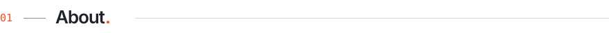
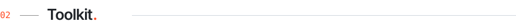
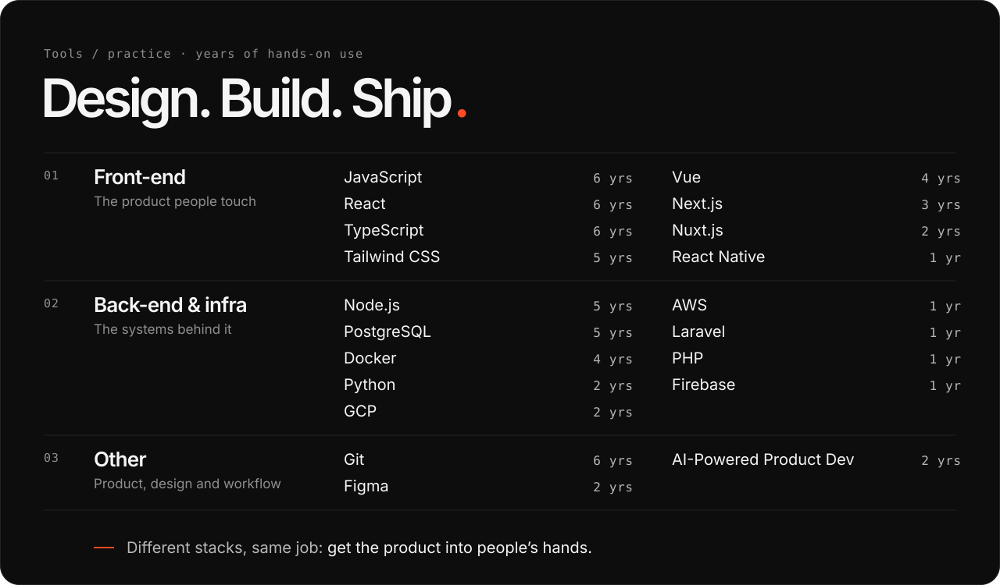
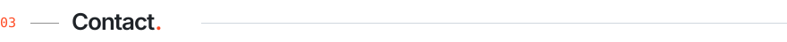
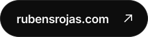

  

<picture>
  <source media="(prefers-color-scheme: dark)" srcset="./assets/section-about-dark.svg">
  
</picture>

### Howdy! I'm Rubens, a Senior Full-Stack Software Engineer with 6+ years of experience, passionate about building interactive and animated platforms that bring **real** value to the **real world**!

⚡ **Fun fact:** I was born close to the Amazon Rainforest, deep in the heart of Brazil! At 17 years old, I went to Rio to do a Mathematics Bachelor's, where I completely fell in love with coding and then moved to Computer Science!

 

<picture>
  <source media="(prefers-color-scheme: dark)" srcset="./assets/section-toolkit-dark.svg">
  
</picture>

 

 

<picture>
  <source media="(prefers-color-scheme: dark)" srcset="./assets/section-contact-dark.svg">
  
</picture>

 

  &nbsp;&nbsp;

